# iResume 3.0 交互原型：3 套设计方向

每个方向是一个单文件 HTML，没有任何依赖，双击就能在浏览器打开。打开后页面顶部有一条黑色控制条，用来切换方案、切换首页/编辑器、切换桌面/手机视图。

| 方案 | 文件 | 一句话 |
| --- | --- | --- |
| **A · 纸墨** | [a-paper.html](./a-paper.html) | 安静、有书卷气，像在书房写一封自我介绍信 |
| **B · 工作台** | [b-studio.html](./b-studio.html) | 专业高效的深色工具，键盘优先，信息密度高 |
| **C · 向导** | [c-guide.html](./c-guide.html) | 明亮亲和，有完成度和写作小助手一路带着你 |

> 原型里的数据和交互都是真的：点简历上的区块会跳到对应的编辑项；输入时右侧预览实时更新；左侧大纲可以拖动排序；可以切换模板、主题色、字号；能撤销/重做，也能「压缩到一页」。

## 三套方案共用的新交互（不受视觉选择影响）

- **内容 / 设计 双模式**：写内容和调样式分开，右侧检查器跟着当前模式切换。
- **大纲 + 画布 + 检查器** 三栏结构。在画布上点哪里，就编辑哪里。
- **一页适配**：实时提示“超出一页 · 多 N 行”，可以一键压缩（先收行高，再收间距、边距、字号，⌘Z 可撤销）。
- **写作建议**：自动标出没有量化结果的要点，以及“参与”“协助”这类偏弱的开头。
- **保存状态常驻**；版本号和标签收进标题旁的弹出层。
- **首页**：显示最近编辑、提供四种新建方式（空白 / 模板 / 导入 / 粘贴），缩略图和标题分开放，不再重叠。
- **手机端**：底部 Tab 切换「编辑 / 预览 / 设计」；大纲变成横向滑动的标签。

## 各方案的差异点

### A · 纸墨（Editorial）
- 暖米白纸张底色，标题用宋体，正文墨黑，强调色是朱砂红。整体靠细线分隔、大量留白，没有厚重的卡片。
- 首页顶部是杂志刊头式的横向导航，简历缩略图像摊在桌上的纸。
- 大纲做成书的目录，带「01 / 02 / 03」编号；输入框只有下划线。
- 写作建议以「批注」形式出现，像老师在页边写的评语。
- 适合想要“有品位、不像工具”的感觉，偏个人作品气质。

### B · 工作台（Studio）
- 默认石墨深色，可以一键切换浅色；强调色是靛紫。字号 13px，信息密度高。
- 首页左侧是图标栏，带全局 ⌘K 搜索。
- **⌘K 命令面板**：可以跳转区块、切换模板、压缩到一页、导出、切换主题。
- 属性面板式字段（标签在左），底部状态栏显示页数、字数、建议条数和同步状态。
- 适合重度用户、经常维护多份简历的人，风格接近 Figma / Linear。

### C · 向导（Friendly）
- 明亮的浅蓝灰底色，主色是青绿；大圆角浮动卡片，控件更大，更适合触屏。
- 首页有一张**完成度卡片**：显示 82%，列出还差哪几处，点一下直接跳到对应位置。
- 编辑器有**写作小助手**，告诉你“动作 + 做了什么 + 结果数字”的写法；大纲里每个区块显示完成打勾。
- 顶栏显示完成度环。
- 适合首次写简历的学生、求职新手，最“人性化”。

## 截图

| | A 纸墨 | B 工作台 | C 向导 |
| --- | --- | --- | --- |
| 首页 | 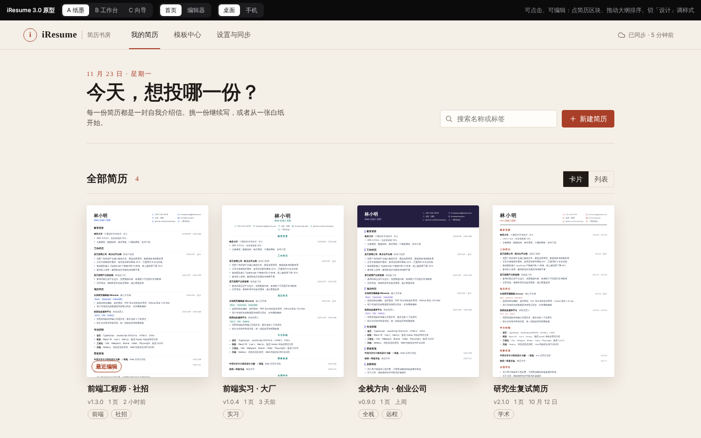 | 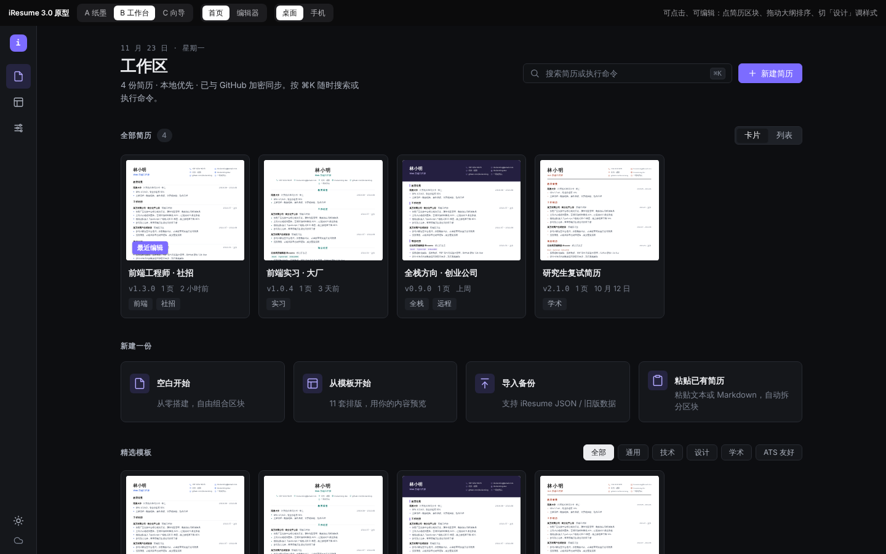 | 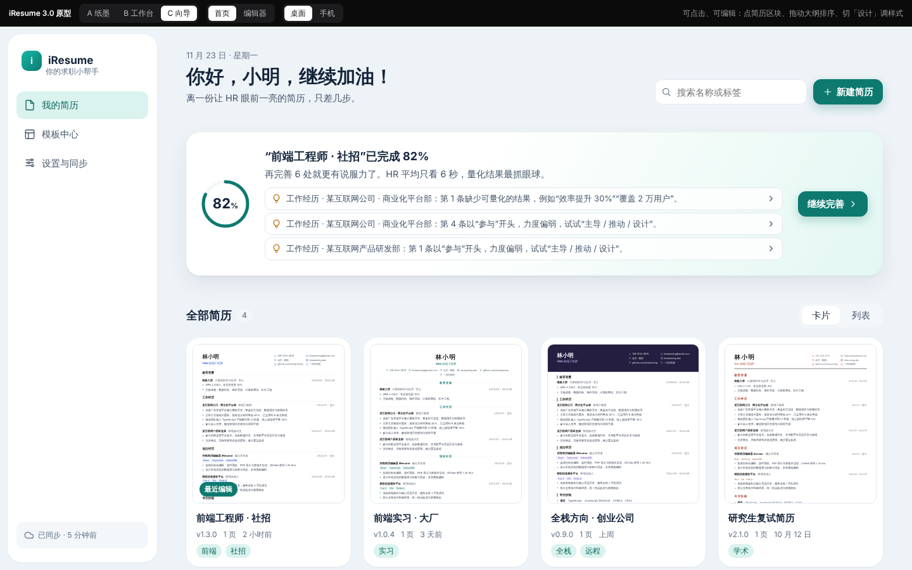 |
| 编辑器 · 内容 | 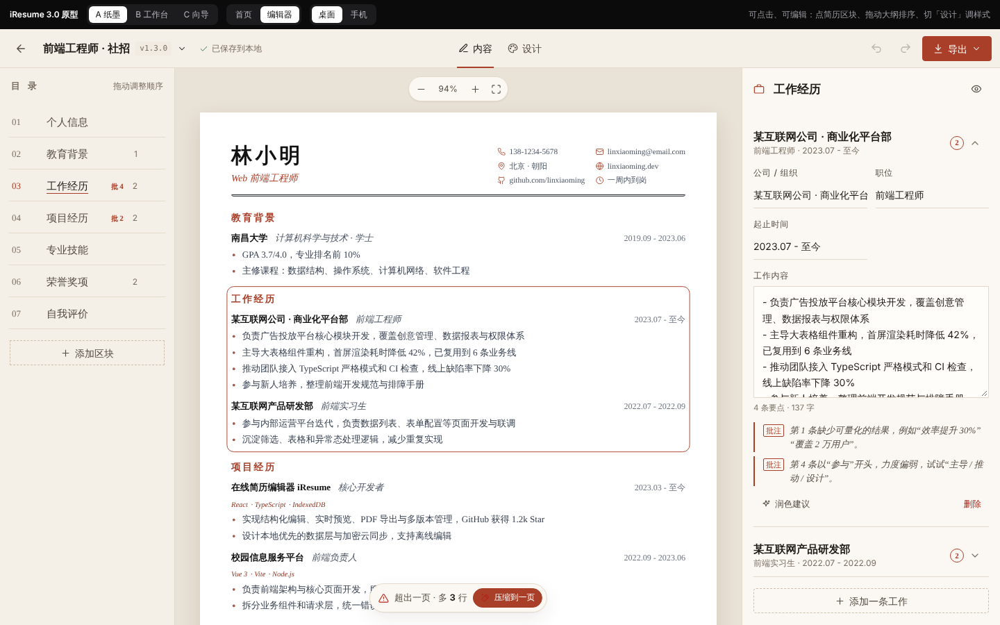 | 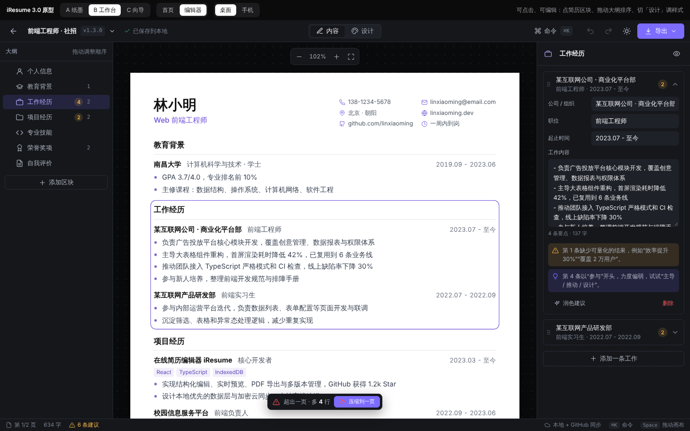 | 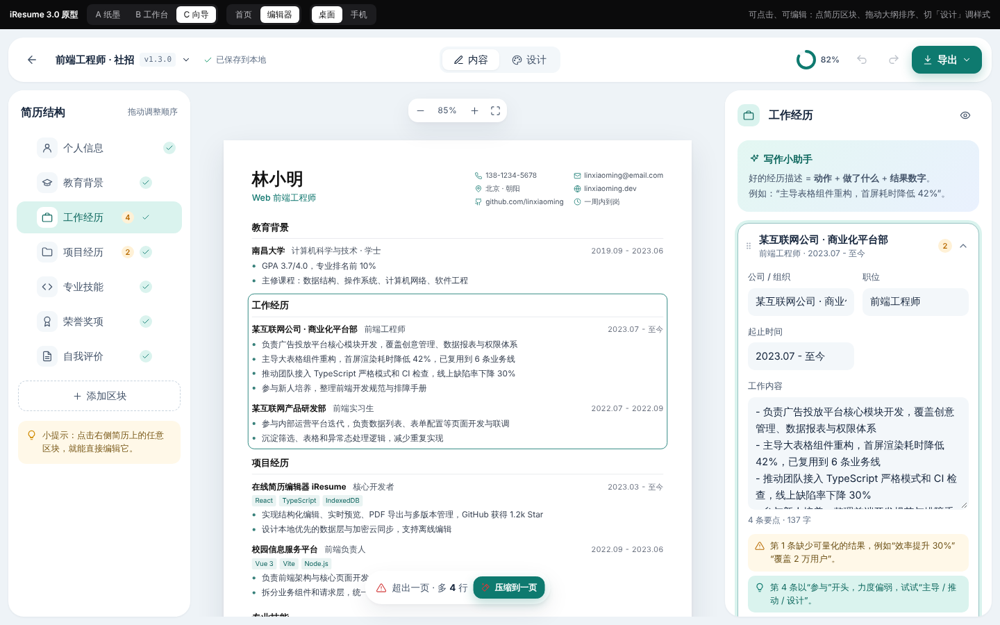 |
| 编辑器 · 设计 | 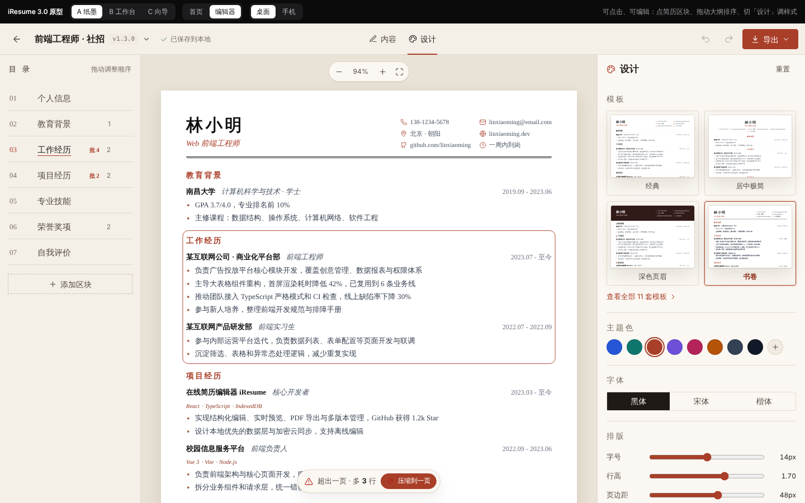 | 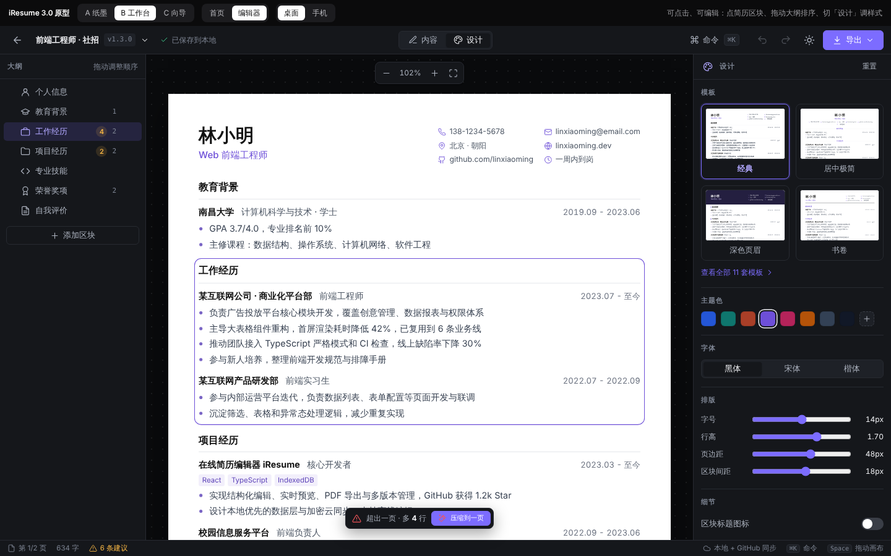 | 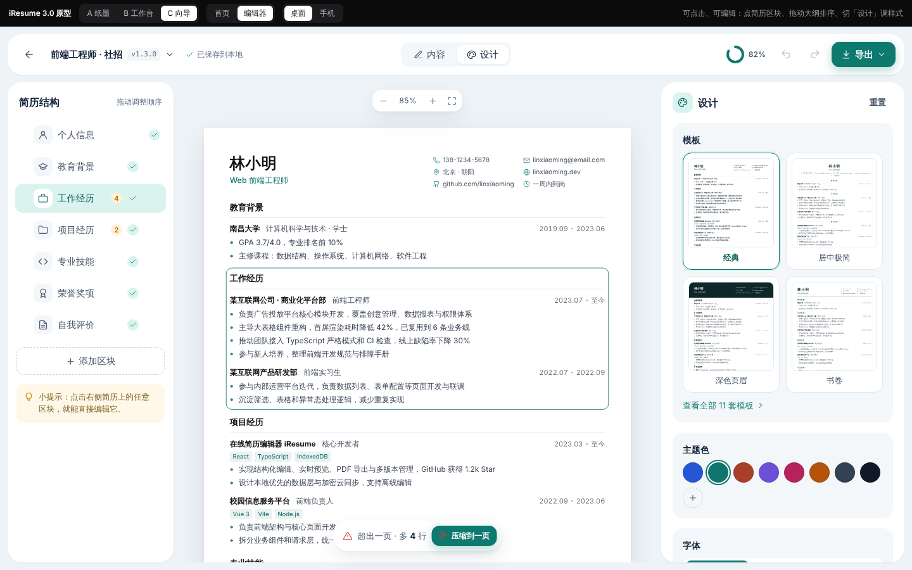 |
| 手机 | 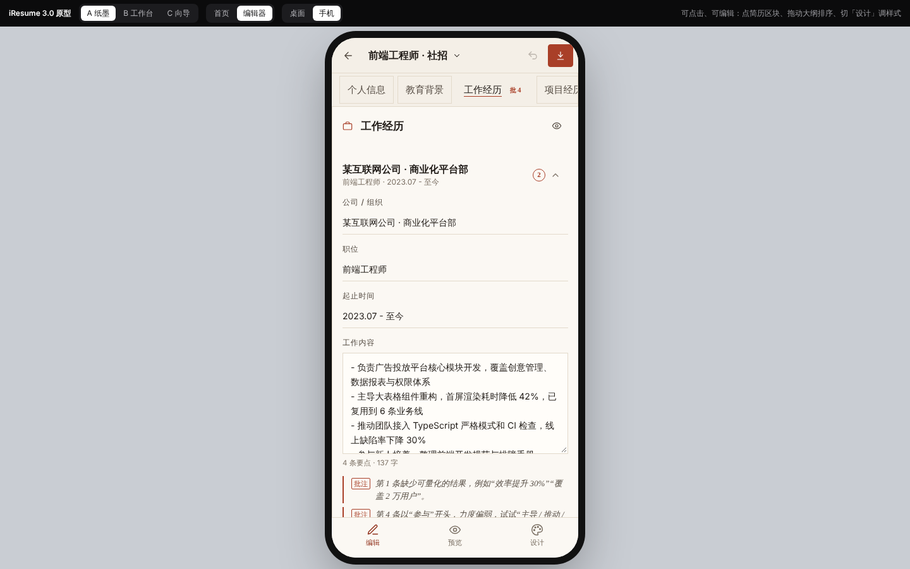 | 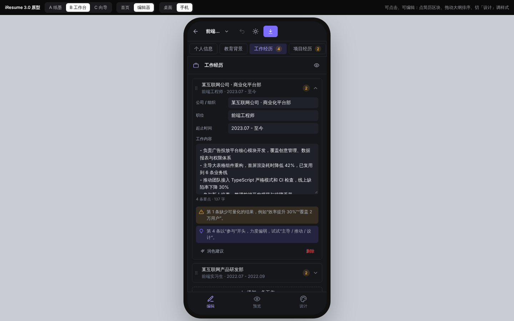 | 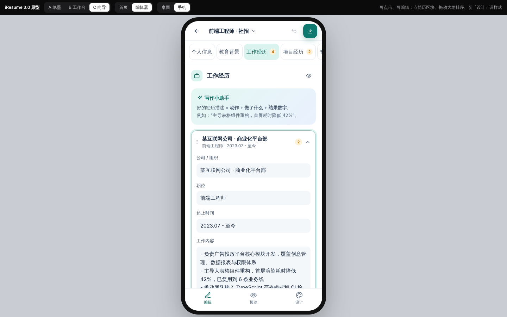 |

## 选完之后

- 可以只选一个方案，也可以混搭，例如「C 的引导 + B 的 ⌘K 和状态栏 + A 的批注式建议」。
- 方向确定后进入 D1 阶段：把所选方向沉淀成 `src/ui/tokens.css` 和基础组件库。

## 修改原型

源码在 `src/`：

- `shared.js`：交互逻辑
- `shared.css`：骨架和简历产物样式
- `theme-*.css`：每个方向的视觉

改完后运行 `node docs/design/prototypes/src/build.mjs` 重新生成三个 HTML。
